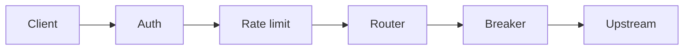

# FireRouter

A small streaming proxy for apps that call Fireworks through the OpenAI SDK and want per-tenant limits and failover without giving up first-token latency.


## Why

- Each tenant has its own request and token budget.
- A model that starts failing is skipped, and the request goes to the next configured model.
- Streams are flushed as each chunk arrives. On the published run, median time to first token was 0.128 ms higher through the proxy than direct.
- One static binary. The container image is distroless and runs as nonroot.

## Try it in 60 seconds

No Fireworks key. The compose file points FireRouter at the mock.

```bash
docker compose -f deploy/docker-compose.yml up --build
```

Grafana is anonymous at [http://localhost:3000](http://localhost:3000). Prometheus is on port 9090. The proxy is on port 8080.

`make demo-up` does the same compose up and also installs the pinned OpenAI package into `demo/.venv`. `make demo-down` stops the stack.

## Use it with your app

Point the OpenAI SDK at FireRouter. The key here is a FireRouter virtual key, not the Fireworks key.

```python
client = OpenAI(
    base_url="http://localhost:8080/v1",
    api_key="fr-your-virtual-key",
)
```

```javascript
const client = new OpenAI({
  baseURL: "http://localhost:8080/v1",
  apiKey: "fr-your-virtual-key",
});
```

The demo stack already has two virtual keys in `deploy/demo.env`. They match the hashes in `deploy/demo-keys.json`.

Against real Fireworks, set the upstream key in the environment and pass a tenant file. The caller's virtual key is never forwarded.

```bash
export FIREWORKS_API_KEY=your-fireworks-key
./bin/firerouter -upstream https://api.fireworks.ai/inference -keys keys.json
```

The proxy then calls `https://api.fireworks.ai/inference/v1/chat/completions`. The same process also forwards `POST /v1/completions`, `POST /v1/embeddings`, and `GET /v1/models`.

## Benchmarks

Measured 14 Nov 2026, 4:27 PM to 4:34 PM Pacific. Load generator, proxy, and mock ran on one machine, so this does not include a network hop between the tester and the proxy.

Hardware: KVM, Linux 6.12.113+, 4 vCPU `Intel(R) Xeon(R) Processor` (family 6, model 207, 1 thread per core), about 16 GB RAM, Go 1.22.2 linux/amd64.

Method: the mock waits 200 ms, then sends 50 tokens 20 ms apart. Loadgen sends 20 requests per second for 30 seconds after a 10 second warmup, concurrency 64. Five direct trials and five proxy trials, alternating. Every trial recorded 600 requests, 0 errors, and 0 responses with status 429. Time to first token is send until the first `data:` line. Percentiles are from an HdrHistogram with 3 significant figures (about 0.128 ms steps near 201 ms). Overhead is the proxy median minus the direct median. Request and token budgets were raised (`-rpm 1000000 -tpm 100000000`) so a rejection would not look like proxy delay. No tenant key file was used.

|  | Direct median | Proxy median | Overhead |
|---|---:|---:|---:|
| p50 | 200.703 ms | 200.831 ms | 0.128 ms |
| p90 | 201.343 ms | 201.471 ms | 0.128 ms |
| p99 | 201.599 ms | 201.727 ms | 0.128 ms |
| p99.9 | 201.599 ms | 201.855 ms | 0.256 ms |

The direct p50 was 200.703 ms on all five trials. The proxy p50 was 200.831 ms on four trials and 200.959 ms on one. The gap between tokens was about 20.6 ms on both paths. Full notes are in [docs/benchmark.md](docs/benchmark.md).

```bash
./bench/run_bench.sh
python3 bench/analyze.py bench/results
```

## Architecture



Auth checks the virtual key before the body is read. The rate limiter reserves a token estimate. The router lists the requested model, then its fallbacks. The breaker skips a model that has been failing. The upstream call uses one shared HTTP client for the life of the process.

SSE is copied one read at a time and flushed on every chunk. The body is not accumulated, and the client does not compress the stream, because either one would hold tokens until a buffer filled. If the client disconnects, the upstream request is cancelled. More detail is in [docs/ARCHITECTURE.md](docs/ARCHITECTURE.md). File descriptors, ephemeral ports, and `GOMAXPROCS` are in [docs/TUNING.md](docs/TUNING.md).

## Configuration

| Flag | Default | Meaning |
|---|---|---|
| `-listen` | `:8080` | Listen address. Env: `FIREROUTER_LISTEN`. |
| `-upstream` | `http://localhost:9000` | Upstream base URL. Env: `FIREROUTER_UPSTREAM`. |
| `-keys` | empty | Tenant file. Empty allows every caller, and `-rpm` / `-tpm` apply to each caller. |
| `-config` | empty | Fallback file. |
| `-rpm` | `600` | Requests per minute when no key file is set. |
| `-tpm` | `200000` | Tokens per minute when no key file is set. |
| `-inject-usage` | off | On streamed chats, set `stream_options.include_usage` so a refund can use the upstream usage chunk. |
| `-version` |  | Print the build version and exit. Set with `-X main.version` or the image `VERSION` build arg. |

`FIREWORKS_API_KEY`, when set, is the only `Authorization` value sent upstream.

```bash
./bin/firerouter keygen --tenant alice --rpm 600 --tpm 200000
```

That prints the virtual key once (`fr-` plus 32 random characters) and a JSON entry that stores the sha256 hash. SIGHUP reloads the key file. A file that does not parse leaves the previous keys in place.

Key file:

| Field | Meaning |
|---|---|
| `tenants[].name` | Tenant name. Used for the budget and for rate-limit metrics. |
| `tenants[].key_sha256` | Hex sha256 of the virtual key. |
| `tenants[].rpm` | Requests per minute for this tenant. |
| `tenants[].tpm` | Tokens per minute for this tenant. |
| `tenants[].allowed_models` | Optional. Omitted means every model. An explicit empty list means none. |

See `deploy/keys.example.json`. The sample digest is sha256 of the placeholder `example-not-a-key` and will not authenticate a request.

Fallback file:

| Field | Meaning |
|---|---|
| `models.<name>.fallbacks` | Models to try, in order, after `<name>`. |

```json
{"models":{"primary":{"fallbacks":["fallback"]}}}
```

A name with no entry is tried alone. Fallbacks of fallbacks are not followed. The response header `X-FireRouter-Model` is the model that served.

Breaker settings are compiled in, not in the file: 30 second window, at least 20 samples, open at a 50% error rate, stay open 15 seconds, then allow 3 probes. Request bodies are capped at 1 MB.

## Compared with LiteLLM and Portkey

FireRouter is a single Go binary aimed at Fireworks streaming latency. The published overhead on this machine is a fraction of a millisecond at the median. LiteLLM and Portkey cover many providers, with budgets, dashboards, and routing features this proxy does not have. FireRouter speaks the Fireworks OpenAI-compatible API only.

## Known limitations

- Rate limits live in memory in each process. With more than one replica, divide the configured rpm and tpm by the replica count.
- Fallback happens only before the first response byte. A failure after headers are sent is not retried.
- A fallback is a different model, so the answer can differ in quality.

## Contributing

Issues and pull requests: [github.com/prayaggaonkar/FireRouter](https://github.com/prayaggaonkar/FireRouter). Build, test, and demo steps are in [CONTRIBUTING.md](CONTRIBUTING.md). Report vulnerabilities the way [SECURITY.md](SECURITY.md) describes.

Apache-2.0. See [LICENSE](LICENSE).
