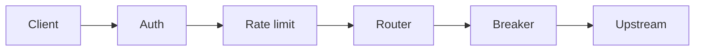

# FireRouter

[](https://deepwiki.com/prayaggaonkar/FireRouter)

A small streaming proxy for apps that call Fireworks through the OpenAI SDK and want per-tenant limits and failover without giving up first-token latency.

## Why

- Each tenant has its own request and token budget.
- A model that starts failing is skipped, and the request goes to the next configured model.
- Streams are flushed as each chunk arrives. On the mock benchmark, median time to first token was 0.128 ms higher through the proxy than direct.
- One static binary. The container image is distroless and runs as nonroot.

## Demo

No Fireworks key. The compose file points FireRouter at the mock.

```bash
docker compose -f deploy/docker-compose.yml up --build
```

Grafana is anonymous at [http://localhost:3000](http://localhost:3000). Prometheus is on port 9090. The proxy is on port 8080.

`make demo-up` does the same compose up and also installs the pinned OpenAI package into `demo/.venv`. `make demo-down` stops the stack.

A public Fly sandbox, still with no Fireworks key, is described in [deploy/fly/README.md](deploy/fly/README.md). `GET /` on that app shows a live metrics summary and curl examples.

## Use it with your app

Point the OpenAI SDK at FireRouter. The key here is a FireRouter virtual key, not the Fireworks key.

```python
client = OpenAI(
    base_url="http://localhost:8080/v1",
    api_key="fr-your-virtual-key",
)
```

```javascript
const client = new OpenAI({
  baseURL: "http://localhost:8080/v1",
  apiKey: "fr-your-virtual-key",
});
```

The demo stack already has two virtual keys in `deploy/demo.env`. They match the hashes in `deploy/demo-keys.json`.

Against real Fireworks, set the upstream key in the environment and pass a tenant file. The caller's virtual key is never forwarded.

```bash
export FIREWORKS_API_KEY=your-fireworks-key
./bin/firerouter -upstream https://api.fireworks.ai/inference -keys keys.json
```

The proxy then calls `https://api.fireworks.ai/inference/v1/chat/completions`. The same process also forwards `POST /v1/completions`, `POST /v1/embeddings`, and `GET /v1/models`.

## Benchmarks

Measured 14 Nov 2026, 4:27 PM to 4:34 PM Pacific. Load generator, proxy, and mock ran on one machine, so this does not include a network hop between the tester and the proxy.

Hardware: KVM, Linux 6.12.113+, 4 vCPU `Intel(R) Xeon(R) Processor` (family 6, model 207, 1 thread per core), about 16 GB RAM, Go 1.22.2 linux/amd64.

Method: the mock waits 200 ms, then sends 50 tokens 20 ms apart. Loadgen sends 20 requests per second for 30 seconds after a 10 second warmup, concurrency 64. Five direct trials and five proxy trials, alternating. Every trial recorded 600 requests, 0 errors, and 0 responses with status 429. Time to first token is send until the first `data:` line. Percentiles are from an HdrHistogram with 3 significant figures (about 0.128 ms steps near 201 ms). Overhead is the proxy median minus the direct median. Request and token budgets were raised (`-rpm 1000000 -tpm 100000000`) so a rejection would not look like proxy delay. No tenant key file was used.

|  | Direct median | Proxy median | Overhead |
|---|---:|---:|---:|
| p50 | 200.703 ms | 200.831 ms | 0.128 ms |
| p90 | 201.343 ms | 201.471 ms | 0.128 ms |
| p99 | 201.599 ms | 201.727 ms | 0.128 ms |
| p99.9 | 201.599 ms | 201.855 ms | 0.256 ms |

The direct p50 was 200.703 ms on all five trials. The proxy p50 was 200.831 ms on four trials and 200.959 ms on one. The gap between tokens was about 20.6 ms on both paths. Full notes are in [docs/benchmark.md](docs/benchmark.md).

```bash
./bench/run_bench.sh
python3 bench/analyze.py bench/results
```

## Architecture



Auth checks the virtual key before the body is read. The rate limiter reserves a token estimate. The router lists the requested model, then its fallbacks. The breaker skips a model that has been failing. The upstream call uses one shared HTTP client for the life of the process.

SSE is copied one read at a time and flushed on every chunk. The body is not accumulated, and the client does not compress the stream, because either one would hold tokens until a buffer filled. If the client disconnects, the upstream request is cancelled. More detail is in [docs/ARCHITECTURE.md](docs/ARCHITECTURE.md). File descriptors, ephemeral ports, and `GOMAXPROCS` are in [docs/TUNING.md](docs/TUNING.md).

## Configuration

| Flag | Default | Meaning |
|---|---|---|
| `-listen` | `:8080` | Listen address. Env: `FIREROUTER_LISTEN`. |
| `-upstream` | `http://localhost:9000` | Upstream base URL. Env: `FIREROUTER_UPSTREAM`. |
| `-keys` | empty | Tenant file. Empty allows every caller, and `-rpm` / `-tpm` apply to each caller. |
| `-config` | empty | Fallback file. |
| `-rpm` | `600` | Requests per minute when no key file is set. |
| `-tpm` | `200000` | Tokens per minute when no key file is set. |
| `-ip-rpm` | `0` | Requests per minute for one client address. `0` turns the per-address limit off. `GET /healthz` is not counted. The address is `Fly-Client-IP` when that header is set, otherwise the TCP peer. `X-Forwarded-For` is not used. |
| `-upstream-header-timeout` | `60s` | How long to wait for upstream response headers. A non-streaming completion sends none until it finishes. A timeout counts as a failure for the breaker. |
| `-max-body` | `1048576` | Maximum inbound request body, in bytes. The response stream is not capped. |
| `-status` | off | Serve a read-only metrics page at `GET /`. |
| `-inject-usage` | off | On streamed chats, set `stream_options.include_usage` so a refund can use the upstream usage chunk. |
| `-version` |  | Print the build version and exit. Set with `-X main.version` or the image `VERSION` build arg. |

`FIREWORKS_API_KEY`, when set, is the only `Authorization` value sent upstream.

```bash
./bin/firerouter keygen --tenant alice --rpm 600 --tpm 200000
```

That prints the virtual key once (`fr-` plus 32 random characters) and a JSON entry that stores the sha256 hash. SIGHUP reloads the key file. A file that does not parse leaves the previous keys in place.

Key file:

| Field | Meaning |
|---|---|
| `tenants[].name` | Tenant name. Used for the budget and for rate-limit metrics. |
| `tenants[].key_sha256` | Hex sha256 of the virtual key. |
| `tenants[].rpm` | Requests per minute for this tenant. |
| `tenants[].tpm` | Tokens per minute for this tenant. |
| `tenants[].allowed_models` | Optional. Omitted means every model. An explicit empty list means none. |

See `deploy/keys.example.json`. The sample digest is sha256 of the placeholder `example-not-a-key` and will not authenticate a request. An `allowed_models` id has to be one `GET /v1/models` returns for the account. The sample uses `accounts/fireworks/models/nemotron-lightning-3p5-30b-a3b`, which this account listed on 20 Nov 2026.

Fallback file:

| Field | Meaning |
|---|---|
| `models.<name>.fallbacks` | Models to try, in order, after `<name>`. |

```json
{"models":{"primary":{"fallbacks":["fallback"]}}}
```

A name with no entry is tried alone. Fallbacks of fallbacks are not followed. The response header `X-FireRouter-Model` is the model that served.

Breaker settings are compiled in, not in the file: 30 second window, at least 20 samples, open at a 50% error rate, stay open 15 seconds, then allow 3 probes. Request bodies are capped at 1 MB unless `-max-body` sets another size.

## Deployment notes

- `GET /metrics` and `GET /healthz` are not authenticated. Keep the listener on a private network, or put it behind a proxy that restricts those paths.
- `-ip-rpm` takes the client address from `Fly-Client-IP` when that header is present. Fly overwrites it, but anywhere else a caller can set it. Use `-ip-rpm` only behind Fly, or behind a proxy that strips the header.
- Metric labels for model and tenant names are capped at 64 values each, and extra names are reported as `other`. The breaker registry holds at most 256 models and extra names share one breaker. This stops a caller from growing memory by inventing model names.
- In open mode (no `-keys`), rate-limit metrics use the tenant label `anonymous`, and idle per-caller budgets are dropped after 10 minutes.
- Token budgets use an estimate: about 4 bytes per token of string message content, plus `max_tokens`. Array (multimodal) content counts as zero. With `-inject-usage` on streamed chats, the unused part is refunded from the real usage chunk.
- The benchmark table above is the mock, on one machine. It was not remeasured against live Fireworks.

## Live Fireworks check

On 20 Nov 2026 the proxy was pointed at `https://api.fireworks.ai/inference`. The key stayed in the environment. Every chat set `max_tokens` to 16. The model was `accounts/fireworks/models/nemotron-lightning-3p5-30b-a3b`. `bench/live_check.sh` refuses to start unless `LIVE_CONFIRM=1`. It does not write the key or the prompt. This was 22 calls that Fireworks accepted as generations, under a cap of 25. The stored chat `usage` objects add up to 798 tokens (22 prompt + 16 completion on each stored chat). `POST /v1/completions` also returned 200; that usage object was not stored.

- `GET /v1/models` returned 200 and included this model. An earlier list on the same day had 31 models and did not include `accounts/fireworks/models/llama-v3p1-8b-instruct`.
- One non-streaming chat and one streaming chat returned 200. The stream sent a `data:` line before the body ended, then `data: [DONE]`. Both answers included `usage` with `-inject-usage` off. On this model the 16 completion tokens were reasoning tokens, `finish_reason` was `length`, and the message text was empty. That is what Fireworks returned.
- One streamed chat with `-inject-usage` returned 200, with a `data:` line, `data: [DONE]`, and a `usage` object. The flag did not change a body Fireworks already accepts.
- `POST /v1/completions` with the prompt `ok` returned 200 and was one upstream call.
- `POST /v1/embeddings` with the input `ok` returned 400, `embedding is not supported`. That was one upstream call and it was not retried. This model does not serve embeddings.
- With `-keys`: a missing virtual key was 401 and the upstream status counter did not move. A model outside `allowed_models` was 403 and the counter did not move. A valid virtual key was one 200 generation.
- With `-rpm 1`, the first chat was 200 and the second, in the same minute, was 429 from FireRouter with `Retry-After: 60`. The upstream status counter moved by 1.
- A model name that does not exist still returns Fireworks' 404, `Model not found, inaccessible, and/or not deployed`. The proxy forwards that status. Fallback runs on connection failures and on 500, 502, 503, and 504, not on 404. That 404 check was the earlier call on the same day, not part of the 22.

Responses carried `X-FireRouter-Model`, `X-FireRouter-Request-ID`, and Fireworks' `X-Request-Id` and `X-Ratelimit-Over-Limit`.

After those checks, eight streaming chats went straight to Fireworks and eight went through FireRouter, one at a time, same model and `max_tokens`. Time to first `data:` line, on a Darwin 25.6.0 arm64 machine:

| | direct | through FireRouter | proxy minus direct |
|---|---:|---:|---:|
| p50 | 236.5 ms | 224.8 ms | -11.7 ms |
| p90 | 254.4 ms | 226.4 ms | -28.0 ms |

Each side used 304 tokens. Eight calls is a sample. The direct times already spread from about 219 ms to 267 ms, so the negative difference is noise, not a claim that the proxy is faster. `GET /metrics` on that proxy process showed `firerouter_ttft_seconds` and `firerouter_proxy_overhead_seconds` at 8 observations each.

Not measured live: a breaker trip, failover in the middle of a stream, and the 0.128 ms mock overhead in the table above. The mock table stays the mock result. `bench/run_bench.sh` was not pointed at Fireworks.

## Known limitations

- Rate limits live in memory in each process. With more than one replica, divide the configured rpm and tpm by the replica count.
- Fallback happens only before the first response byte. A failure after headers are sent is not retried. A stream that is cut mid-way gets a final `upstream_stream_error` SSE event and counts as a breaker failure.
- A fallback is a different model, so the answer can differ in quality.

## Build

Go 1.22.2 or newer.

```bash
make build
make test
```

`make build` writes `bin/firerouter`, `bin/mockupstream`, and `bin/loadgen`. `make test` runs `go vet ./...` and `go test -race ./...`. A local build prints version `dev`.
