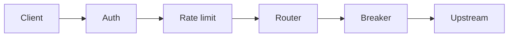

# Architecture

FireRouter sits in front of a model server. An app sends an OpenAI-compatible request. FireRouter checks the caller, checks that caller's budget, picks a model, and copies the answer back one piece at a time. It does not run the model.

The production model server is Fireworks: `https://api.fireworks.ai/inference/v1/...`. `mockupstream` is the stand-in used by tests and the demo.



## Request

```json
{"model":"small","stream":true,"messages":[{"role":"user","content":"hi"}]}
```

`stream: true` is server-sent events. Each piece is a line starting with `data:`. The last line is `data: [DONE]`.

A request that never starts a stream gets JSON instead: 400 for a body the proxy cannot read, 401 for an unknown key, 403 for a model the key may not call, 429 when the caller is over budget, 503 when no model can answer.

Routes: `POST /v1/chat/completions`, `POST /v1/completions`, `POST /v1/embeddings`, `GET /v1/models`.

## Steps

1. With `-keys`, the `Authorization: Bearer fr-…` value is hashed and compared with the sha256 hashes in the file. The comparison does not stop at the first different byte. The tenant name next to the matching hash is the budget name and the `tenant` label on rate-limit rejections. A missing or unknown key is 401, and the body is not read. `allowed_models`, when set, rejects any other model with 403. With no key file, every caller is allowed and the budget name is a hash of whatever header they sent. `firerouter keygen` prints a new key once and the hash to store.
2. The body is read, up to 1 MB.
3. The budget is checked before the upstream call. With a key file, `rpm` and `tpm` come from that tenant. Otherwise the process flags apply (`-rpm` 600, `-tpm` 200000). The reserve is about 4 characters per token, plus 4 tokens per message, plus `max_tokens` (1024 when the field is absent). `-inject-usage` asks a streamed chat for a usage chunk and refunds the difference. With the flag off, the reserve stands.
4. The candidate list is the requested model, then the names under `fallbacks`, in order. Fallbacks of fallbacks are not followed. A name with no entry is tried alone.
5. Each model has its own breaker. After 20 samples in 30 seconds, an error rate of at least 50% opens it for 15 seconds and new calls skip that model. Then 3 probes are allowed. Success closes it and clears the window. A failure is a dropped connection, headers that never arrive within 10 seconds, or status 500, 502, 503, or 504. A 400-class status is the caller's problem and is not a sample. An upstream 429 is a backoff, not a failure, and is passed through.
6. The upstream body uses the candidate's model name. `FIREWORKS_API_KEY`, when set, is the only `Authorization` value the model server sees. The caller's key is not copied.
7. Headers are the commit point. A failure before headers, or a 5xx, tries the next candidate. The first good response is the one the app sees. `X-FireRouter-Model` names it. After that, each read is written and flushed. A break in the middle of the answer is not retried.
8. If the app disconnects, the request context is cancelled, and so is the upstream call.

## Why the stream is not buffered

The copy loop uses a 16 KB scratch buffer from a pool. It is a place to read one chunk, not a place to assemble the answer. `Flush` runs after every write. The shared HTTP client disables compression, because a compressed body would sit until a buffer filled. There is no overall timeout on the client: a timeout there would cut a stream that is still sending tokens. The dial timeout is 3 seconds. The wait for response headers is 10 seconds. The server's write timeout is off for the same reason. The header read timeout is 5 seconds.

One `http.Client` and one `http.Transport` live for the process. Idle connections to a host are capped at 64 and expire after 90 seconds. HTTP/2 is attempted so many streams share those connections.

## Process

`GET /healthz` answers `ok` and does not call the model.

`GET /metrics` is Prometheus text: time to the first response byte, proxy overhead, active streams, upstream status codes, rate-limit rejections, requests by the model that served them, and each model's breaker state (0 closed, 1 open, 2 half-open). Prompts and keys are not labels.

SIGHUP reloads the key file. Streams that already started keep going. A file that does not parse leaves the previous keys in place. SIGINT and SIGTERM stop new calls and wait up to 30 seconds for streams to finish.

Rate limits are in memory in that process. See [TUNING.md](TUNING.md) for file descriptors, ephemeral ports, and `GOMAXPROCS`.

## Programs

| Program | Role |
|---|---|
| `firerouter` | The proxy. |
| `mockupstream` | A fake model. A model name containing `broken` returns 503. |
| `loadgen` | Sends chats on a fixed timer and reports wait times. |

`loadgen` measures from send until the first `data:` line. The proxy's own metric measures until the first response byte, which is a few bytes earlier.
